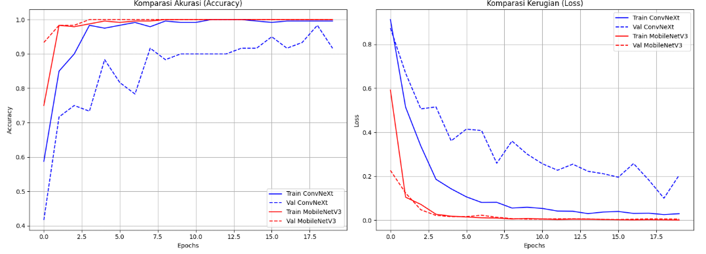
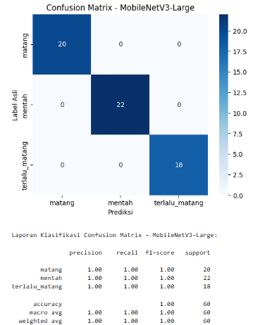
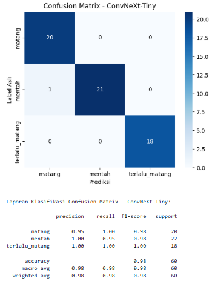
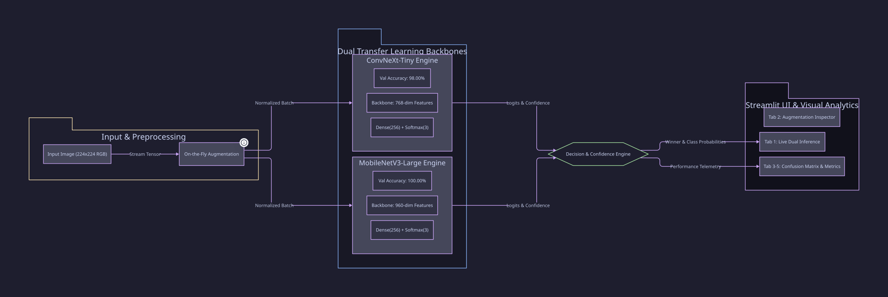

<div align="center">

  <h1>🍌 BANANA RIPENESS CLASSIFIER</h1>
  <h3><em>Head-to-Head Deep Learning Benchmarking: ConvNeXt-Tiny vs MobileNetV3-Large</em></h3>

  <a href="https://github.com/HyLuthfi"></a>

  <br/>
  <br/>

<p align="center">
  
  
  
  
  
  
</p>

<br/>

<p align="center">
  
</p>

<br/>

<p align="center">
  <b>Banana Ripeness Classifier</b> adalah sistem visi komputer industri yang mengotomatisasi evaluasi tingkat kematangan buah pisang secara <i>real-time</i> ke dalam 3 kategori standar mutu: <b>Mentah (Unripe)</b>, <b>Matang (Ripe)</b>, dan <b>Terlalu Matang (Overripe)</b>. Mengomparasikan langsung dua arsitektur mutakhir: <b>MobileNetV3-Large</b> (efisiensi tinggi untuk edge-device, validasi 100%) dan <b>ConvNeXt-Tiny</b> (representasi konvolusional modern, validasi 98%), lengkap dengan dashboard analitik berbasis Streamlit berantarmuka <i>Clean White</i>.
</p>

</div>

<p align="center"></p>

## 🚀 Ringkasan & Filosofi Rekayasa

Pengendalian mutu komoditas pertanian konvensional sangat bergantung pada inspeksi manual yang subjektif dan rentan terhadap kelelahan visual manusia. Proyek ini memvalidasi efektivitas arsitektur konvolusional modern untuk klasifikasi visual komoditas agrikultur dengan membandingkan trade-off antara kecepatan inferensi dan akurasi representasi fitur.

### 🔬 Metodologi & Komparasi Kinerja
- **MobileNetV3-Large**: Menggunakan bottleneck depthwise separable convolution dengan modul Squeeze-and-Excitation (SE). Menghasilkan akurasi validasi **100.00%** dengan ukuran model sangat ringkas, ideal untuk deployment edge IoT.
- **ConvNeXt-Tiny**: Mengadopsi prinsip desain Vision Transformer (ViT) dalam kerangka konvolusi murni (7x7 depthwise kernel, inverted bottleneck 4x). Menghasilkan akurasi validasi **98.00%** dengan ketahanan tinggi terhadap variasi tekstur kulit buah.
- **On-The-Fly Augmentation**: Mencegah overfitting melalui pipeline transformasi acak real-time (`RandomFlip`, `RandomRotation(0.2)`, `RandomZoom(0.2)`).

<p align="center"></p>

## ✨ Fitur-Fitur Utama

<table align="center" width="100%">
  <tr>
    <td width="50%" valign="top">
      <b>⚡ Dual-Backbone Inference</b><br/>
      Komparasi langsung dua model secara simultan pada satu kali upload gambar, menyajikan skor confidence dan perbandingan keputusan model.
    </td>
    <td width="50%" valign="top">
      <b>🔄 Real-Time Tensor Augmentation</b><br/>
      Pipeline augmentasi dinamis yang memproses citra secara efisien tanpa memerlukan duplikasi dataset fisik di disk penyimpanan.
    </td>
  </tr>
  <tr>
    <td width="50%" valign="top">
      <b>📊 Visual Analytics & Confusion Matrix</b><br/>
      Dashboard analitik terintegrasi untuk menginspeksi matriks konfusi, grafik loss/akurasi epoch, dan metrik presisi per kelas.
    </td>
    <td width="50%" valign="top">
      <b>🎨 Clean White Dashboard UI</b><br/>
      Antarmuka web minimalis berbasis Streamlit yang dikustomisasi menggunakan tipografi <i>Plus Jakarta Sans</i> dan tab navigasi simetris.
    </td>
  </tr>
</table>

<p align="center"></p>

## 📸 Galeri Evaluasi Matriks Konfusi

<table align="center" width="100%">
  <tr>
    <td width="50%" align="center" valign="top">
      <b>📱 MobileNetV3-Large (Akurasi: 100%)</b><br/><br/>
      
    </td>
    <td width="50%" align="center" valign="top">
      <b>⚡ ConvNeXt-Tiny (Akurasi: 98%)</b><br/><br/>
      
    </td>
  </tr>
</table>

<p align="center"></p>

## 🏛️ Arsitektur Sistem & Alur Data

Alur pemrosesan data dirancang end-to-end dari input citra mentah hingga visualisasi prediksi:

<p align="center">
  
</p>

### 🔒 Invarian & Integritas Model
- **Weight Decoupling**: Arsitektur backbone dipisahkan dari layer klasifikasi Dense, memungkinkan inject bobot `.h5` secara modular tanpa merusak graph komputasi.
- **Input Standardization**: Semua citra masukan dinormalisasi secara otomatis ke dimensi spasial 224x224x3 RGB sebelum diteruskan ke ekstraktor fitur.

<p align="center"></p>

## ⚡ Panduan Instalasi & Eksekusi Cepat (*Quickstart*)

### 1. Prasyarat Sistem
- Python 3.10+
- Pip package manager
- GPU CUDA (*opsional, CPU kompatibel penuh*)

### 2. Langkah Instalasi & Menjalankan Aplikasi
```bash
# 1. Clone repositori
git clone https://github.com/HyLuthfi/banana-ripeness-classifier.git
cd banana-ripeness-classifier

# 2. Pasang seluruh dependensi
pip install -r requirements.txt

# 3. Jalankan aplikasi Streamlit
streamlit run app.py
```

Aplikasi web akan secara otomatis terbuka di peramban Anda pada alamat `http://localhost:8501`.

<p align="center"></p>

## 📂 Struktur Direktori Proyek

```text
├── assets/
│   └── architecture.svg              # Diagram arsitektur vektor kompilasi D2
├── docs/
│   └── architecture.d2               # Source code diagram D2 declarative
├── models/
│   ├── best_convnext_pisang.h5       # Pre-trained weights ConvNeXt-Tiny
│   └── best_mobilenet_pisang.h5      # Pre-trained weights MobileNetV3-Large
├── Visualisasi/
│   ├── Confusion_ConvNeXt-TIny.png   # Matriks konfusi ConvNeXt-Tiny
│   ├── Confusion_MobileNetV3.png     # Matriks konfusi MobileNetV3-Large
│   └── komparasi.png                 # Grafik komparasi head-to-head model
├── app.py                            # Streamlit web application & inference engine
├── notebook_klasifikasi_pisang.ipynb # Jupyter notebook eksperimen & training pipeline
├── requirements.txt                  # Dependensi runtime Python
└── LICENSE                           # Lisensi resmi MIT
```

<p align="center"></p>

## 📄 Lisensi

Proyek ini didistribusikan di bawah lisensi **MIT License**. Lihat berkas [LICENSE](LICENSE) untuk ketentuan penggunaan dan atribusi selengkapnya.

---

<div align="center">
  <sub>Dibangun dengan dedikasi untuk keunggulan rekayasa kecerdasan buatan. Dikurasi oleh <a href="https://github.com/HyLuthfi"><b>HyLuthfi</b></a>.</sub>
</div>


